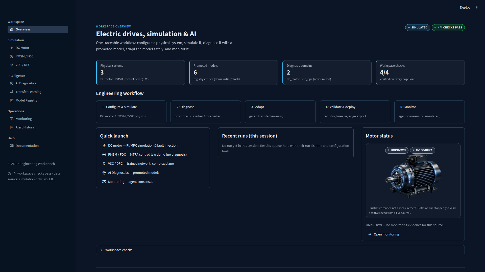

# SPADE

**S**imulation **P**latform for **A**nalysis, **D**iagnosis & **E**lectric drives.

A unified simulation, differentiable predictive control (DPC), and ML fault-diagnosis workbench
for electric drives and power electronics converters, with an interactive Streamlit dashboard -- now also
covering transfer learning on already-promoted models and a simulation-based multi-agent monitoring view.
Nothing on the dashboard is pre-generated or looked up from a table -- every chart is the direct
output of a real simulation, run fresh each time you click Generate.



> **Status of the evidence.** Every signal in SPADE is simulated; there is no hardware ingestion.
> Edge `.tflite` files are exported, not hardware-verified. The vibration model is a coarse,
> one-axis calibration that does not generalise per bearing. See
> [`AUDIT_ANSWERS.md`](AUDIT_ANSWERS.md) (Q01–Q30) and
> [`CHANGELOG_IMPLEMENTATION.md`](CHANGELOG_IMPLEMENTATION.md) for the audit of the AI layer and
> what was changed. External circuit plants (PLECS, OpenModelica FMUs), their GO/NO-GO verdicts
> and the DC-plant discretization study (S-16/S-18) are summarised in
> [`docs/VALIDATION_SUMMARY.md`](docs/VALIDATION_SUMMARY.md) §11.

**Demo video:** [SPADE on YouTube](https://www.youtube.com/watch?v=qoHtqhicAgY)

## What's inside

Three physically distinct systems, unified under one interface:

| System | Plant | Controller | Fault/robustness angle |
|---|---|---|---|
| **1. DC motor** | Permanently-excited DC motor (same physics/parameters as [gym-electric-motor](https://github.com/upb-lea/gym-electric-motor)) | Native cascaded PI or linear MPC (speed or torque, `controller_type="PI"`/`"MPC"` -- genuinely interchangeable, same plant) | Bearing-fault injection on two independent paths: torque ripple (electrical/MCSA) and synthetic 3-axis vibration |
| **2. PMSM FOC/MTPA** | Salient permanent-magnet synchronous motor | Native dq-frame field-oriented current control, MTPA vs. naive policy | Control-law comparison against the analytic MTPA locus and current-limit circle |
| **3. DPC / Voltage Source Converter** | VSC + L-C filter, identified 2-state model (power electronics, no rotating machinery) | Trained Direct Power Control (DPC) neural network, ported from [DPC4PowerElectronics](https://github.com/aipoweraau/DPC4PowerElectronics) | Off-distribution robustness probes (load resistance, reference magnitude/frequency) + a dataset-upload evaluator for your own data |

System 1 also feeds a fault-injection/diagnosis data-generation pipeline (`src/driveflow/datagen/`)
and a config-driven ML diagnosis stack (`src/driveflow/models/`, `src/driveflow/ai/`,
`src/driveflow/monitoring/`) -- see the "AI layer" section below.

**System 2 (PMSM) produces datasets but has no diagnosis.** Since 2026-10-20 it is a `Scenario`
plant (`plant_config_id="pmsm_v1"`, `controller_type` `"FOC_MTPA"` or `"FOC_naive"`, reference
`pmsm_current_ref_a`): `run_scenario` emits records with the shared schema plus `i_d`, `i_q`, their
references, `u_d`, `u_q` and `omega_rad_s` (`experiments/generate_pmsm_dataset.py`). It still has
**no fault model**, so every record is `normal` and no classifier exists for it; the dashboard's
PMSM page keeps calling `control/classical/pmsm_foc.py` directly for its MTPA-vs-naive comparison.

The dashboard is a multipage Streamlit app (*SPADE · Engineering Workbench*, `src/driveflow/viz/app.py`)
with native navigation; the five original macro-phases map onto its sections:

| Section / page | Former phase | What it does |
|---|---|---|
| Workspace · **Overview** | landing | Real workspace checks, engineering workflow, this session's runs, motor status (UNKNOWN until monitored), clickable system diagram |
| Workspace · **Experiment Runs** | -- | Durable job queue and run history. Long jobs (sweeps, tuning, RL, classifier training) run in a separate worker process; every run keeps its configuration hash, seed, versions, logs and a reproducible command |
| Workspace · **Environments** | -- | Gymnasium environments over SPADE's plants (`SPADE/DcMotor-v0`, `SPADE/Vsc-v0`, `SPADE/Buck-v0`, `SPADE/BuckSurrogate-v0`, `SPADE/Pmsm-v0`, and `SPADE/OmBuck-v0` on the OpenModelica FMU of the averaged buck when the FMU is built): observation, action, reward, limits. An FMU environment that cannot run here is listed as not available, with the reason |
| Simulation · **DC Motor** | A | PI or MPC, bearing-fault injection (MCSA + synthetic vibration), KPIs, time signals, spectrum (FFT) with simulator-computed BPFO/BPFI markers, AI suggestion, operating envelope, provenance + export; Advanced Flow mode |
| Simulation · **PMSM / FOC** | A | FOC/MTPA control-law demo -- explicitly *no diagnosis* |
| Simulation · **VSC / DPC** | B | Trained DPC network tracking, complex plane, dataset-upload evaluator |
| Simulation · **DC-DC Converters** | -- | Averaged synchronous buck under a PI cascade; DAB modulation selector (its simulation needs PLECS) |
| Simulation · **PLECS Plant Studio** | -- | Datasets from PLECS Standalone RPC sweeps (needs a local PLECS licence), surrogate plants fitted to them, comparison with SPADE's native buck. **Use as a Gymnasium plant** with an FMU exported by OpenModelica or PLECS (FMI 2.0/3.0, Co-Simulation or Model Exchange, uploaded): six stages (goal, engine, circuit, signals, Gym behavior, validate & publish), a 13-check verification job, and publication as `SPADE/Fmu<Profile>-v0`; FMUs with a NO-GO feasibility verdict cannot be published. Researchers with PLECS: [PLECS researcher kit](docs/guides/PLECS_RESEARCHER_KIT.md) |
| Design & Control · **Tuning Studio** | -- | PSO / Bayesian / NSGA-II tuning of the DC-motor PI speed loop, and PSO / Bayesian tuning of the buck PI on any available buck environment (native, surrogate or OpenModelica FMU), on a tuning grid compared with the baseline on a separate evaluation grid. Systems are listed by capability. Results are candidates |
| Design & Control · **RL Lab** | -- | DQN / DDPG on SPADE's environments (listed by capability, including `SPADE/OmBuck-v0`), benchmarked against the classical controllers on the same grid. Policies are candidates |
| Intelligence · **AI Diagnostics** | IA | **Evaluate a model**: the promoted classifier, or any other classifier on this machine, on a sample run (same options as the simulation pages) or an uploaded file. **Train a model**: a classifier over several fault classes and a custom simulated grid -- see below |
| Intelligence · **Transfer Learning** | TL | 4-step gated wizard (Data → Setup → Validate → Promote) starting from the promoted model, any other model on this machine or an imported Keras model; full or feature transfer -- see below |
| Intelligence · **Model Registry** | IA | Every run on disk: status from evidence, lineage, gate, artifacts with SHA-256, edge-export lifecycle, rollback |
| Operations · **Monitoring** | LM | SIMULATED monitoring: agent consensus, status from *all* active alerts, motor status, acknowledge |
| Operations · **Alert History** | LM | Filterable, exportable alert log |
| Help · **Documentation** | -- | Status semantics, data formats, known limitations |
| Help · **Algorithm Guide** | -- | Three questions → an algorithm family, its assumptions and limits, and the SPADE page that implements it |

A full, phase-by-phase snapshot of what the platform does today is kept in
[`docs/plataforma_estado_actual.md`](docs/plataforma_estado_actual.md).

## AI layer

A config-driven classifier/regressor stack, a model registry, edge-tier deployment, and
rule-based monitoring agents -- transversal to both domains (`dc_motor`, `vsc_dpc`) without ever
mixing their data or models. Full design rationale in
[`docs/design_ai_layer_transversal.md`](docs/design_ai_layer_transversal.md); this is the short
version.

**Classifiers & regressors** (`src/driveflow/models/{classifiers,regressors}/`): a YAML config
(architecture, tier, domain) plus a generic builder (`build_classifier`/`build_forecaster`) --
adding a layer or changing a kernel size means editing a config file, not touching Python. One
script trains any of them:

```bash
python experiments/train_model.py --config configs/classifiers/pc_server.yaml --dataset data/diagnosis_dataset.parquet
```

**The promoted `dc_motor` classifier (since 2026-10-20).** `pc_server_5class_w2048/2026-10-20_run01`, and the RPi5 tier `rpi5_resnet1d_se_5class_w2048`.
- **Classes:** healthy, outer race, inner race, ball and cage.
- **Data and preprocessing:** trained on an operating-condition grid (7 speeds × 5 severities, sensor noise, plant drift) with 2048-sample (205 ms) windows. It keeps the rpm level as a speed reference and is temperature-calibrated with an abstention threshold.
- **Synthetic-only classes:** ball and cage have an **uncalibrated amplitude**. The GUI labels those answers.
- **ESP32 tier:** it keeps the 3-class `esp32_dscnn/2026-10-18_run01`, because the 5-class int8 export is not usable.

```bash
python experiments/generate_diagnosis_grid_dataset.py --faults outer_race,inner_race,ball,cage \
    --out data/diagnosis_grid_dataset_5class.parquet                    # ~12 min
python experiments/train_model.py --config configs/classifiers/pc_server_5class_w2048.yaml \
    --dataset data/diagnosis_grid_dataset_5class.parquet --keep-rpm-level --cap-per-class 3000 --epochs 30
```

Held-out evaluation and its limits (simulated data only; weaker start-up transient):
[docs/AI_TECHNICAL_AUDIT.md](docs/AI_TECHNICAL_AUDIT.md) §8.4–8.5. The previous 3-class model (`pc_server/2026-10-18_run01`, §7) stays in the registry history for `rollback()`.

**Training your own classifier from the GUI** (AI Diagnostics → *Train a model*,
`src/driveflow/ai/custom_training.py`). The promoted models were trained by scripts on fixed grids;
this tab lets you define your own grid with the same options as the simulation pages and train on it:

| Step | Options |
|---|---|
| 1 · Classes | Any number of fault modes: healthy, outer race, inner race, ball, cage and your saved custom fault types (characteristic orders defined on the DC Motor page). For `vsc_dpc`: normal vs. capacitor degradation (capacitance and ESR ranges). |
| 2 · Operating conditions | PI and/or MPC; speed or torque control; a range of setpoints; fault-severity scales; electrical severity; PI setpoint weight. For `vsc_dpc`: load resistances, reference magnitudes and frequencies, converter voltage limit. |
| 3 · Robustness | Maximum sensor noise and the share of noise-free runs; per-run drift of ψ_e, rotor inertia and r_a; base motor parameters. |
| 4 · Runs | Duration, discarded start-up, runs per cell, grid seed. |
| 5 · Model | Architecture preset (PC / Raspberry Pi 5 / ESP32 families), window length, **input channels** (e.g. current only for an MCSA model), epochs, batch size, windows per class, validation/test shares, training seed, rpm level, OOD detector. |

The page shows the number of runs per class and a rough time estimate before you start. The job
runs in the worker (Experiment Runs → *Start local worker*), so you can keep using SPADE meanwhile.
Every class gets the same operating cells; train, validation and test are split **by run**. The
result -- test macro-F1, per-class recall, confusion matrix, OOD detector -- is a **candidate** saved
under `configs/classifiers/custom/<name>/<date>_runNN/` (gitignored, like its dataset in
`data/custom/`). You can select it in *Evaluate a model* or use it as the starting point for transfer
learning. It is never promoted from this page.

Step-by-step guide for training, evaluating and adapting models in the GUI: [docs/GUIDE_AI_TRAINING_AND_TRANSFER.md](docs/GUIDE_AI_TRAINING_AND_TRANSFER.md).

**Model registry** (`src/driveflow/ai/registry.py`): a single manifest
(`configs/registry.yaml`) resolving `(domain, tier, block)` to whichever trained run is promoted
to production (`experiments/promote_run.py`) -- a deliberate, separate step from training.

**Edge deployment** (Raspberry Pi 5, ESP32): the promoted PC-tier model is distilled into a
smaller architecture per tier (`--distill` on the training script -- DS-CNN/TCN blocks for ESP32,
which structurally can't use recurrent layers) and exported to TFLite (`experiments/export_tflite.py`
-- float16 for Raspberry Pi 5, int8 calibrated on windows sampled from the simulated training dataset for ESP32). The dashboard's IA
tab has a direct download for each promoted `.tflite` file.

**Monitoring agents** (`src/driveflow/monitoring/`): a rule schema (`rules/schema.py`, validated
YAML conditions, no `eval()`) plus one agent per tier -- ESP32 is pure hard-coded thresholds (no
ML), a Raspberry Pi 5 `GatewayAgent` evaluates rules with hysteresis/debounce and can run
disconnected from the PC tier, and a PC-tier `ServerAgent` aggregates alerts across domains and
tracks classifier confidence over time to flag drift.

Try it in the dashboard: open **AI Diagnostics**, generate a sample run or upload a file, and see the
trained classifier/regressor evaluate it on demand. The Overview page also has a clickable system
diagram showing how these pieces connect end to end.

## Transfer Learning workbench

Fine-tuning a model that is already promoted, without retraining it from scratch
(`src/driveflow/ai/transfer/`, plus the dashboard's "Transfer Learning" macro-phase):

- **`loader.py`** wraps the existing registry API (`resolve`/`load_promoted_model`) -- no parallel
  YAML schema and no registry format change. `load_by_generation()` additionally loads *any* past
  run directory by path (promoted or not), so a fine-tune can be stacked on a previous fine-tune.
- **`data_merger.py`** merges freshly-simulated data with external data by **whole acquisitions**
  (`source_file`), never individual rows; `mix_ratio` is measured in training windows and the
  realized ratio is reported. IDs are prefixed `sim::`/`ext::`; groups with out-of-order
  timestamps or a sampling rate other than 10 kHz are excluded, never re-sorted or resampled.
- **`dataset_validation.py`** is the *training* contract for uploads (keeps `label`, `source_file`,
  `timestamp_s` and other metadata; base-model channels and class vocabulary required) -- distinct
  from the inference-only validators used by AI Diagnostics.
- **`pipeline.py`** implements three fine-tune strategies for real: `FEATURE_EXTRACTOR` (freeze the
  first N layers, then a normal `fit()`), `DISCRIMINATIVE_LR` (a manual per-layer-group
  `tf.GradientTape` loop -- Keras `fit()` has no per-layer learning rate), and `ADAPTER` (freeze
  everything but the last N trainable layers; a deliberately simplified, architecture-agnostic
  reading of parameter-efficient fine-tuning, *not* LoRA). An `on_epoch_end` hook feeds the
  dashboard's per-epoch loss chart and fires identically on both paths.
  The pipeline always fine-tunes a **clone** of the base model and verifies the base weights'
  SHA-256 fingerprint afterwards.
- **`validator.py`** is task-specific: classification (accuracy, macro-F1, per-class recall,
  confusion matrix, mode collapse) and regression (MAE, RMSE per horizon step, finiteness,
  constant-output detection, vs. base and vs. a persistence baseline), plus convergence. Each check
  is PASS / FAIL / NOT_APPLICABLE / INCOMPLETE; INCOMPLETE blocks.
- **`workflow.py`** runs the whole path without Streamlit: grouped train/val/test split by
  acquisition (no leaky fallback), single evaluation of base *and* candidate on the same test set,
  lineage, candidate saving.
- **`../promotion.py`** is the fail-closed `PromotionGate` (dataset integrity, split
  independence, single test evaluation, validation checks, base unchanged, lineage, human
  approval). `ai/registry.py`'s `promote()` re-evaluates the persisted evidence of any
  transfer-learning run and refuses it unless approved; promotions are atomic, appended to
  `configs/registry_history.yaml`, and reversible with `rollback()`.

**Base model.** The wizard can start from:
1. the promoted model of the domain;
2. any other model on this machine: a classifier trained in AI Diagnostics, an earlier
   transfer-learning candidate, or a historical run;
3. an **imported third-party model** (`src/driveflow/ai/transfer/external.py`). The page lists the
   supported formats:

| Format | Supported? |
|---|---|
| SPADE run directory (`config.yaml` + `model.weights.h5` + `metrics.json`) | Yes |
| Keras v3 `.keras`, full model | Yes. Loaded in safe mode; `Lambda` layers and non-Keras custom layers are refused. |
| Keras HDF5 `.h5`, full model (`model.save()`) | Yes, with the same checks |
| Weights-only `.weights.h5` | No: there is no architecture to rebuild |
| TensorFlow SavedModel, TFLite | No: Keras 3 cannot fine-tune them (inference only) |
| ONNX, PyTorch | No: they would need converter dependencies that SPADE does not install. Convert to `.keras` first. |

An imported classifier must have one input `(window, channels)` and a softmax `Dense` output. You
declare which SPADE channels its inputs are and which classes its outputs are. It is saved as a run
under `configs/classifiers/external/` (gitignored). SPADE feeds it its own per-window z-scored
windows, because the model's original preprocessing is unknown.

**Transfer mode** (step 2):
- **Full transfer learning** fine-tunes every layer: one learning rate (`FULL_FINETUNE`), or a
  larger rate on the output layer (`DISCRIMINATIVE_LR`).
- **Feature transfer learning** reuses the base model's learned features: freeze the first N
  layers (`FEATURE_EXTRACTOR`), train only the last N (`ADAPTER`), or train a **new output layer**
  on the frozen features (`NEW_HEAD`).
- Only `NEW_HEAD` can learn **classes the base model does not have**. For example, a 3-class model
  can be extended with `cage` or a custom fault.

**Acceptance floors** (decision D1, 2026-10-22): every classification candidate needs **macro-F1 ≥
0.88** and **recall ≥ 0.70 for every class** on its independent test set. A reviewer may raise these
floors but not lower them, and the gate report records each floor's value and origin. When the class
set changes, the base model cannot be scored on the same test set, so the base-vs-candidate check is
NOT_APPLICABLE and the floors decide. The gate still needs a named reviewer's approval.

In the dashboard the page is a 4-step wizard: **Data** (simulate + optionally upload, prepare
dataset → hash, split manifest, integrity checks), **Setup** (strategy, epochs, proposed
thresholds flagged as requiring confirmation, train), **Validate** (loss curves, base vs.
fine-tuned on the same independent test set, checks), **Promote** (gate decision; *Save as
candidate* writes `<config>_tl/<date>_runNN/` without touching the registry; *Promote* is enabled
only when the gate is APPROVED, and the registry re-checks it anyway). Pushing the new run down to
Raspberry Pi 5/ESP32 reuses the existing `--distill` flag on `experiments/train_model.py`; it is
not a separate mechanism.

The tab deliberately does *not* offer a "pick a new architecture" control: fine-tuning changes
weights (and, with `NEW_HEAD`, only the output layer). Choosing a different architecture means
training from scratch, which AI Diagnostics → *Train a model* and `experiments/train_model.py` cover.

## Simulation-based agents & Monitoring

A second, complementary detection path that needs no trained classifier at all
(`src/driveflow/agents/`): compare a real telemetry window against *simulations* of hypothetical
scenarios (one healthy + N anomalous) and score how much closer the telemetry sits to healthy than
to the nearest fault hypothesis.

- **`base.py`** holds the one shared, concrete `detect_anomaly` algorithm, driven by a `HYPOTHESES`
  class attribute (name -> partial `Scenario` kwargs) that each subclass defines. Only
  `simulate_scenario` is abstract, because only that part is genuinely domain-specific.
- **`detector.py`** implements the distance metrics directly against numpy/scipy -- DTW (exact
  O(n*m) dynamic programming, vectorized per row; no DTW library is a project dependency), strict
  equal-shape Euclidean, and Mahalanobis (pseudo-inverse for near-singular covariances).
- **`dc_motor_agent.py` / `vsc_agent.py`** define hypotheses that match each domain's *actual*
  `Scenario` shape: outer- and inner-race severity pairs for `dc_motor`, simulated at the observed
  speed, and variations of `load_resistance_ohm` away from the DPC network's training value for
  `vsc_dpc`, which has no fault model at all. Features are z-scored with the healthy hypothesis's
  statistics; vibration and current are compared by log-PSD (AI-N09/AI-N10). On 60 labelled
  simulated runs the DC score separates healthy from faulty with ROC AUC 1.0
  (`experiments/report_anomaly_agent_roc.py`).
- **`cache.py`** is a real TTL cache so a hypothesis simulation isn't re-run per telemetry window.
- **`explainer.py`** returns feature importance for the score -- which channels explain most of the
  distance between the telemetry and the closest hypothesis.

The **Monitoring page** (`viz/views/monitoring.py`, labelled *SIMULATED MONITORING* -- each pass
synthesises telemetry with `run_scenario()`) is where the three
detection mechanisms meet as one **Agent Consensus**, all feeding a single session-scoped
`ServerAgent`:

1. the simulation-based detector above,
2. the rule-based `GatewayAgent`, where a real rule exists for that domain (today: only `vsc_dpc`),
3. **ML classifier confidence drift** -- each run loads whatever PC-tier classifier is currently
   promoted for the domain (including one just promoted from the Transfer Learning tab, no extra
   wiring), records its confidence, and reports baseline-vs-recent drift once enough history has
   accumulated.

The output is a per-domain status (`ServerAgent.domain_health`: the highest severity among
**all** active alerts, keyed by `(domain, rule, source)`; UNKNOWN until the domain has been
evaluated, never HEALTHY by default), an alert history table
(`ServerAgent.alert_history`), and the feature-importance explanation for the simulation-based
score. Agent state lives in `st.session_state`, not `st.cache_resource` -- the latter is shared
across every session on the same Streamlit server process, which for a stateful agent (alert
history, hysteresis timers) would leak one user's monitoring history into another's.

Note on the `vsc_dpc` rule: it fires for any load resistance below R* ~= 3.37 ohm (the whole
open-loop-unstable region; it used to watch only [1, 3] ohm -- docs/AI_TECHNICAL_AUDIT.md AI-N03)
and is evaluated on every sample of the simulated run (telemetry time, not the time between
clicks) with a 10 ms on-delay and a 10 ms off-delay, so one "Run monitoring" pass with R < R*
fires it (AI-N02/AI-N08).

## Installation, step by step

You need **Python 3.11 or 3.12** (64-bit) and Git. No GPU or CUDA is needed: everything runs on the
CPU. Pick your operating system below and run the commands **in order**, one block at a time. Each
step says what you should see. If a step fails, look for the message in that system's
troubleshooting table, which is in the full guide linked at the end of each section.

<details open><summary><b>Linux (Ubuntu 22.04 / 24.04 / 26.04)</b></summary>

1. **Install the system tools** (Terminal):
   ```bash
   sudo apt update
   sudo apt install -y git curl build-essential
   ```
2. **Install `uv`.** It downloads a supported Python by itself, so the system Python version does
   not matter:
   ```bash
   curl -LsSf https://astral.sh/uv/install.sh | sh
   source "$HOME/.local/bin/env"
   uv --version                       # prints a version, e.g. uv 0.9.x
   ```
3. **Get the code:**
   ```bash
   git clone https://github.com/lucianoradrigan/SPADE.git
   cd SPADE
   ```
4. **Create the environment and install SPADE** (a few minutes; TensorFlow is ~600 MB):
   ```bash
   uv venv --python 3.11 .venv
   source .venv/bin/activate          # the prompt now starts with (.venv)
   uv pip install -e ".[dev,viz]"
   ```
5. **Check the installation:**
   ```bash
   python scripts/smoke_test.py       # every line [PASS]; the last one "6. no exceptions: PASS"
   ```
6. **Open SPADE:**
   ```bash
   streamlit run src/driveflow/viz/app.py
   ```
   The browser opens at http://localhost:8501. Stop it with `Ctrl+C`.
7. **Next time:** `cd SPADE`, `source .venv/bin/activate`, then step 6.

Without `uv` (Ubuntu 24.04, system Python 3.12): `sudo apt install -y python3.12-venv`, then
`python3.12 -m venv .venv`, `source .venv/bin/activate`, `pip install -e ".[dev,viz]"`.
Full guide and troubleshooting: [docs/INSTALL_UBUNTU.md](docs/INSTALL_UBUNTU.md).
</details>

<details open><summary><b>Windows 10 / 11 (PowerShell)</b></summary>

Use **PowerShell**, not WSL. Open it from the Start menu ("Windows PowerShell").

1. **Install Python 3.12 and Git:**
   ```powershell
   winget install --id Python.Python.3.12 -e
   winget install --id Git.Git -e
   ```
   **Close and reopen PowerShell**, then check:
   ```powershell
   py -3.12 --version                 # Python 3.12.x
   git --version
   ```
   If you install Python from python.org instead, take the **64-bit** installer and tick
   **"Add python.exe to PATH"**.
2. **Allow long paths (once).** TensorFlow has very deep file paths. Open PowerShell **as
   Administrator** (right click → *Run as administrator*), run the command below, then **reboot**:
   ```powershell
   New-ItemProperty -Path "HKLM:\SYSTEM\CurrentControlSet\Control\FileSystem" -Name "LongPathsEnabled" -Value 1 -PropertyType DWORD -Force
   ```
3. **Get the code into a short path** (a normal PowerShell again):
   ```powershell
   mkdir C:\dev -Force
   cd C:\dev
   git clone https://github.com/lucianoradrigan/SPADE.git
   cd SPADE
   ```
4. **Create the environment and install SPADE** (a few minutes):
   ```powershell
   py -3.12 -m venv .venv
   .\.venv\Scripts\Activate.ps1          # the prompt now starts with (.venv)
   python -m pip install --upgrade pip
   pip install -e ".[dev,viz]"
   ```
   If activation fails with *"running scripts is disabled on this system"*, run
   `Set-ExecutionPolicy -Scope CurrentUser -ExecutionPolicy RemoteSigned` once, then activate again.
5. **Check the installation:**
   ```powershell
   python scripts\smoke_test.py        # every line [PASS]; the last one "6. no exceptions: PASS"
   ```
6. **Open SPADE:**
   ```powershell
   streamlit run src\driveflow\viz\app.py
   ```
   The browser opens at http://localhost:8501. If Windows Defender Firewall asks about `python.exe`,
   allowing **private networks** is enough. Stop it with `Ctrl+C`.
7. **Next time:** `cd C:\dev\SPADE`, `.\.venv\Scripts\Activate.ps1`, then step 6.

Common errors: `DLL load failed while importing _pywrap_tensorflow_internal` →
`winget install Microsoft.VCRedist.2015+.x64`; `Could not find a version that satisfies the
requirement tensorflow` → you have 32-bit Python or Python 3.13+, so install 64-bit 3.12;
`WinError 206` → step 2 was skipped or the clone path is too long.
Full guide and troubleshooting: [docs/INSTALL_WINDOWS.md](docs/INSTALL_WINDOWS.md).
**Status: the Windows steps were checked by dependency resolution and CI configuration, not run on a
Windows machine.**
</details>

<details open><summary><b>macOS (Apple Silicon M1–M4, and Intel)</b></summary>

1. **Find out which Mac you have** (Terminal):
   ```bash
   uname -m                           # arm64 = Apple Silicon, x86_64 = Intel
   ```
   On Apple Silicon, `x86_64` means the Terminal runs under Rosetta. Use a native Terminal.
2. **Install the tools:**
   ```bash
   xcode-select --install             # Git and compilers; skip if already installed
   /bin/bash -c "$(curl -fsSL https://raw.githubusercontent.com/Homebrew/install/HEAD/install.sh)"   # only if Homebrew is missing
   brew install python@3.12 git
   python3.12 --version               # Python 3.12.x
   ```
3. **Get the code:**
   ```bash
   git clone https://github.com/lucianoradrigan/SPADE.git
   cd SPADE
   ```
4. **Create the environment and install SPADE.**

   **Apple Silicon:**
   ```bash
   python3.12 -m venv .venv
   source .venv/bin/activate
   python -m pip install --upgrade pip
   pip install -e ".[dev,viz]"
   ```
   **Intel Mac.** Use Python 3.12 **and** the constraints file. Without it the install breaks,
   because the last TensorFlow for Intel Macs is 2.16:
   ```bash
   python3.12 -m venv .venv
   source .venv/bin/activate
   python -m pip install --upgrade pip
   pip install -e ".[dev,viz]" -c constraints/macos-intel.txt
   ```
5. **Check the installation:**
   ```bash
   python scripts/smoke_test.py       # every line [PASS]; the last one "6. no exceptions: PASS"
   ```
6. **Open SPADE:**
   ```bash
   streamlit run src/driveflow/viz/app.py
   ```
   The browser opens at http://localhost:8501. If macOS asks whether Python may accept incoming
   connections, you can **Deny** for local use. Stop it with `Ctrl+C`.
7. **Next time:** `cd SPADE`, `source .venv/bin/activate`, then step 6.

Do not install `tensorflow-metal`: SPADE does not need it. Common errors: `pyarrow requires NumPy 2.0
or newer` on an Intel Mac → reinstall with `-c constraints/macos-intel.txt`; `illegal hardware
instruction` → the environment was created under Rosetta, so recreate `.venv` with
`/opt/homebrew/bin/python3.12`. Full guide and troubleshooting: [docs/INSTALL_MACOS.md](docs/INSTALL_MACOS.md).
**Status: the macOS steps were checked by dependency resolution (both architectures) and an Intel
package set emulated on Linux, not run on a Mac.**
</details>

### Using SPADE after installing

- `streamlit run src/driveflow/viz/dashboard.py` is the legacy command for the same app and still works.
- **Long jobs** (sweeps, tuning, RL, classifier training) need the background worker. Start it from
  **Experiment Runs → Start local worker**, or in a second terminal run
  `python -m driveflow.jobs.worker serve` with the environment active.
- Light and dark themes are both native (app menu ⋮ → Settings → Theme). The app follows the OS
  preference.
- **OpenModelica FMU plants** (`SPADE/OmBuck-v0`, Plant Studio → Use as a Gymnasium plant) need the
  `fmu` extra and the FMUs: `pip install -e ".[fmu]"`, then `scripts/fmu/build_fmus.sh` (Docker,
  pinned OpenModelica 1.27.1). `python -m driveflow.fmu fetch` downloads prebuilt Linux x86_64 FMUs
  (SHA-256 checked) once a release is published; the first one, `fmu-v1`, is still a draft. See
  `docs/guides/BUILD_FMUS_LOCALLY.md`; licence notices in `licenses/fmu/`.
- **FMUs from PLECS or other tools** (Plant Studio → Use as a Gymnasium plant → engine *PLECS FMU*):
  upload the `.fmu` (FMI 2.0 or 3.0). A **Model Exchange** export (PLECS Coder) runs without PLECS:
  SPADE integrates it with RK4 and locates switching events, which is how switching circuits run
  (the OpenModelica switching buck that aborts in Co-Simulation runs this way). A Co-Simulation export
  from PLECS needs PLECS installed and licensed on the same computer. Every FMU passes the 13-check
  verification before it becomes an environment; one without a native counterpart is labelled
  "no native comparison". No PLECS-exported FMU has been run yet
  ([evidence](docs/audit/plecs_om/p1_fmu_me_fmi3.md)).

### Assisted setup with an AI coding assistant

[`SETUP_CON_AGENTE.md`](SETUP_CON_AGENTE.md) (in Spanish) is a self-contained setup guide for
Windows, Linux and macOS, written to be handed to a coding assistant such as Claude Code or Codex.
Attach the file, or point the assistant at it, and ask:

> Sigue las instrucciones de `SETUP_CON_AGENTE.md` para instalar y abrir SPADE en mi computador.
> *(Follow the instructions in `SETUP_CON_AGENTE.md` to install and open SPADE on my computer.)*

The guide makes the assistant:
1. Detect the operating system and CPU architecture.
2. Install into a local `.venv`.
3. Run the smoke test.
4. Open the GUI at http://localhost:8501.
5. Finish with a short report.

Before any system-level change (installing Python or Git, `sudo`, the Windows registry, the
PowerShell execution policy), the assistant asks for confirmation. It does not edit the repository
or retrain models.

A person can follow the same file by hand.

### Tests and reports

The exact environment the test suite was verified in is pinned in `requirements-lock.txt`
(`uv pip install -r requirements-lock.txt && uv pip install -e . --no-deps`; Linux only).

Check the installation (imports, app start, modules, a short simulation of every plant, one
model inference -- same command on every OS):

```bash
python scripts/smoke_test.py            # add --launch to also start the real Streamlit server
```

Run the tests:

```bash
pytest                       # everything
pytest -m "not slow"         # what CI runs per commit
pytest -m simulation         # or: control, ai, compat, slow
pytest -m fmu                # FMU tests (need the fmu extra and built FMUs, incl. the Model Exchange variants; skipped otherwise)
```

Validation and audit reports: [docs/VALIDATION_SUMMARY.md](docs/VALIDATION_SUMMARY.md) (start
here) · [simulation stability](docs/SIMULATION_STABILITY_REPORT.md) ·
[AI technical audit](docs/AI_TECHNICAL_AUDIT.md) ·
[demo validation scenarios](docs/DEMO_VALIDATION_SCENARIOS.md).

`dev` (`pytest`) and `viz` (`streamlit`, `plotly`) are both needed to run the full test suite --
some tests drive the dashboard itself via `streamlit.testing.v1.AppTest`, so `viz` isn't only a
dashboard-runtime dependency. `pip install -e ".[dev]"` alone will fail to even collect those
test files. Core simulation/control code (`numpy`, `scipy`, `tensorflow`, ...) installs with the
package itself.

## Repository layout

```
src/driveflow/
  sim/            physics: DC/PMSM/induction motor models, VSC plant, bearing-fault injection,
                  synthetic vibration synthesis
  control/
    classical/    PI controller, PMSM FOC/MTPA
    mpc/          linear MPC (QP per step) for the DC motor -- interchangeable with PI, same plant
    dpc/          DPC network, model-based training loss, receding-horizon controller
    rl/           DQN / DDPG agents (Keras), policy controller, benchmark against classical controllers
  datagen/        Scenario dataclass + runner -- turns a config into a simulated dataset/trace
  models/         config-driven classifier/regressor builders + schemas, common windowing/splits,
                  training.py (the training code behind experiments/train_model.py and the GUI)
  ai/             model registry (configs/registry.yaml), TFLite export, calibration/OOD,
                  custom_training.py (AI Diagnostics -> Train a model)
    transfer/     transfer-learning stack: registry-backed loader, data merger, 5 fine-tune
                  strategies (full / feature transfer), third-party model import, promotion validator
  envs/           Gymnasium environments over the native plants, the buck surrogate and OpenModelica
                  FMUs (fmu_env.py: FmuGymEnv, SPADE/OmBuck-v0, plants published from Plant Studio)
  jobs/           durable job queue (SQLite) + worker process: sweeps, tuning, RL, classifier training
  runs/           run store, experiment specs, plant profiles, run comparison
  optim/          PSO, Bayesian optimisation (GP), NSGA-II and the tuning objectives
  integrations/   PLECS Standalone RPC client and batch sweeps; fmu/ (FmuAdapter over fmpy: FMI 2.0/3.0,
                  Co-Simulation and Model Exchange; Plant Studio FMU profiles, uploads, verification
                  and publication)
  fmu/            python -m driveflow.fmu fetch -- prebuilt FMUs from a GitHub Release (SHA-256 checked)
  agents/         simulation-based anomaly agents: shared detect_anomaly + per-domain hypotheses,
                  DTW/Euclidean/Mahalanobis metrics, TTL simulation cache, feature-importance
                  explainer
  monitoring/     rule schema/YAML + the ESP32/Raspberry Pi 5/PC monitoring agents
  analysis/       display-grade spectrum (Hann-windowed amplitude spectrum, peak)
  validation/     stability/performance bench: plants with a selectable ODE solver, load-step
                  disturbance, step-response metrics, Euler stability bounds
  viz/            app.py (navigation) + dashboard.py (legacy entry); pages/ (thin page scripts),
                  views/ (page UI), components/ (header, KPI, charts, motor status, presets),
                  theme/ (tokens, scoped CSS, Plotly conventions), adapters/ (orchestration over
                  the library -- no numerics); ai_/transfer_learning_/live_monitoring_dashboard.py
                  are compatibility shims
experiments/      standalone scripts: train/promote/export models, fine-tune/evaluate the DPC
                  network, generate diagnosis datasets, calibrate the vibration module;
                  run_stability_battery.py / report_classifier_evaluation.py regenerate docs/audit/
scripts/          smoke_test.py -- cross-platform installation check; fmu/ -- build the OpenModelica FMUs
                  (and their Model Exchange variants) in the pinned Docker image, assemble release assets
modelica/         SPADE's Modelica models (averaged/switching buck and DC motor) exported as FMUs
licenses/fmu/     third-party notices that go with redistributed FMUs
tests/            pytest suite; simulation/, control/, ai/, compat/ hold the categorised
                  validation tests (markers: simulation, control, ai, compat, slow)
constraints/      macos-intel.txt -- dependency pins for Intel Macs
configs/          the 4 shipped DPC checkpoints (see below), promoted classifier/regressor runs
                  (weights + config + metrics, some with a .tflite export), the model registry
                  manifest, and vibration module calibration; classifiers/custom/ and
                  classifiers/external/ hold models trained or imported from the GUI (gitignored)
```

## The DPC checkpoints

`configs/*.weights.h5` ships 4 small (~21KB) trained checkpoints so the dashboard and
`experiments/evaluate_dpc*.py` work immediately, with no local training run required:

- `dpc_trained.weights.h5` -- base checkpoint, trained on `Data4train.mat`'s open-loop holdout split.
- `dpc_trained_v2_closed_loop.weights.h5` / `dpc_trained_v3_closed_loop.weights.h5` -- successive
  closed-loop fine-tunes at the single load R = 8.0064 ohm (see `experiments/finetune_dpc_closed_loop.py` /
  `continue_finetune_dpc.py`).
- `dpc_trained_v4_r_range.weights.h5` -- v3 fine-tuned on closed-loop rollouts over R = 3.5-1000 ohm
  and |v_ref| = 25-100 V (`experiments/finetune_dpc_r_range.py`). It tracks within ~3 V over the dashboard's load range
  (v3: up to 18 V), at the cost of the nominal point (2.5 V vs. v3's 1.18 V at 8 ohm) -- see
  docs/SIMULATION_STABILITY_REPORT.md S-05.
- **What every DPC `Scenario` and the dashboard run (since 2026-10-20):**
  `ScheduledDpcController`, which uses v3 near 8 ohm (7.25-8.75 ohm, |v_ref| <= 62.5 V) and at
  small references (<= 10 V, 5-12 ohm) and v4 everywhere else: 1.18 V at 8 ohm, <= 3.1 V from 4 ohm
  to 1 kohm (docs/SIMULATION_STABILITY_REPORT.md §4.4).

To retrain from scratch you'll need `Data4train.mat` from the original
[DPC4PowerElectronics](https://github.com/aipoweraau/DPC4PowerElectronics) repository (not
redistributed here) -- see `experiments/train_dpc.py --help` and `DATA.md` for the full dependency
note (also covers the KAt-DataCenter/Paderborn bearing dataset the vibration module depends on).

## Classifier/regressor artifacts

`configs/{classifiers,regressors}/` also ships real, already-trained runs for the AI layer above
(one directory per `(config, timestamp)`, each with its weights + the config that produced it +
its metrics) -- the ones actually registered in `configs/registry.yaml` are what the dashboard's
IA tab and edge-deployment downloads use, no local training run required either. Currently
registered: a `dc_motor` classifier (PC/Raspberry Pi 5/ESP32 tiers) and a `vsc_dpc` regressor (same
3 tiers). No `vsc_dpc` classifier is shipped or promoted: capacitor degradation is synthetic-only,
but you can train one from AI Diagnostics → *Train a model*. The `dc_motor` forecaster (E14) is
trained but not promoted (docs/VALIDATION_SUMMARY.md §7.2). Retraining or adding a new
`(domain, tier, block)` combination needs a real dataset first (`experiments/generate_diagnosis_grid_dataset.py`,
`generate_diagnosis_dataset.py`
/ `generate_vsc_dpc_dataset.py`, not committed -- see `.gitignore`), then
`experiments/train_model.py --config ... --dataset ...` and `experiments/promote_run.py`.

## Design notes

- One ML framework throughout: Keras/TensorFlow (no PyTorch, no sklearn/XGBoost as a final model).
- Simulation is decoupled from `gymnasium.Env` -- `SCMLSystem` (`sim/scml_system.py`) is driven
  directly, not through the full Gym environment layer.
- DPC is NOT a drop-in alternative to the classical PI controller: it operates on a different
  physical domain entirely (a Voltage Source Converter -- no motor, no mechanical side, no rotor)
  with no state space, plant, or control objective in common with PI/MPC's motor domain. There is
  no "same conditions" under which to compare DPC vs. PI/MPC performance -- see `docs/patch5_alcance_macrofase_B.md`.
- No large datasets are committed to the repository (see `.gitignore`); the dashboard and
  `datagen/` generate everything on demand.

## Credits

This project consolidates and ports code from two MIT-licensed upstream projects:

- **[DPC4PowerElectronics](https://github.com/aipoweraau/DPC4PowerElectronics)** (Copyright (c)
  2024 AI-Power) -- the original MATLAB Direct Predictive Control implementation for a Voltage
  Source Converter. `src/driveflow/control/dpc/` and `src/driveflow/sim/vsc_system.py` are a
  Keras/TensorFlow port: network architecture, the identified discrete-time plant matrices, and
  the training loss were verified line-for-line against this source.
- **[gym-electric-motor](https://github.com/upb-lea/gym-electric-motor)** (Copyright (c) 2019
  Paderborn University -- LEA) -- `src/driveflow/sim/motors/` adapts its motor physics/parameter
  models, decoupled from its `gymnasium.Env` step-callback interface.

## License

MIT -- see [LICENSE](LICENSE).
